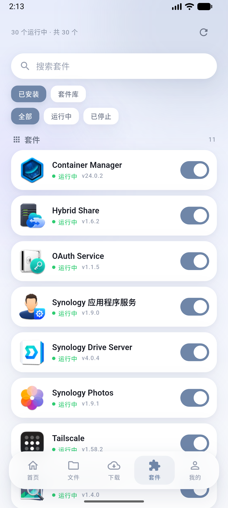

# 群晖助手 · DSM Helper

一套为 **黑群晖 / Synology DSM** 打造的第三方手机管理端。

本仓库在 [0ps/dsm_helper](https://github.com/0ps/dsm_helper) 的基础上重写界面与交互，设计语言参考 **飞牛 fnOS App**：渐变背景、大圆角卡片、悬浮底部导航，以及「一个 App 管完 NAS」的交互方式。所有请求通过群晖官方 WebAPI 直连设备，不经过第三方服务器。

> fork 自 [keduoli-lovely/dsm_helper](https://github.com/keduoli-lovely/dsm_helper) · Apache-2.0

## 界面预览

| 首页 | 文件 | 下载 |
| --- | --- | --- |
|  |  |  |

| 相册 | 套件中心 | Docker |
| --- | --- | --- |
|  |  |  |

| 我的 | 登录 | 资源监控 |
| --- | --- | --- |
|  |  |  |

| 文件浏览 |
| --- |
|  |

## 功能

### 首页

- 设备名、连接状态、网络延迟、当前地址。
- 5×2 快捷宫格，可自由增删卡片：资源监控、存储、传输任务、系统概览、网络、硬盘健康、最近文件、快捷操作、相册预览、套件状态、Docker 容器等。
- 通知入口；没有未读消息时不显示红点。
- 支持本地头像。

### 文件

- 共享文件夹列表、目录浏览、面包屑、当前目录搜索。
- 上传：兼容 Android SAF，显示总进度、当前文件、成功/失败结果；失败弹窗可查看目标路径与完整错误。
- 下载、重命名、删除、图片预览。
- 群晖共享链接：有效期、密码、访问次数。
- 页面顶部固定，只有内容区滚动。

### 相册

- 三种来源：
  - **DSM 文件夹**：递归子目录、流式逐张加载。
  - **Synology Photos**：时间线与缩略图。
  - **Immich**：地址 + API Key。
- 排除 `@eaDir`、`#recycle`、`.@__thumb` 等系统缩略图目录，以及 Immich 的 `thumbs`、`profile`、`upload`、`encoded-video` 等内部目录，避免重复与错误图片。
- 客户端持久化索引缓存：首次扫描后保存图片路径、时间、大小和地址；再次进入直接显示缓存，不重复全量扫描。
- 右上角可刷新；相册刷新只合并新图，不清空已有列表。
- 日期排序（新→旧 / 旧→新）；日期命名的子目录优先扫描。
- 缩略图加载失败自动回退原图。
- 大图查看：顶栏返回 / 日期时间 / 详情，底部分享与保存图片；单击隐藏控件；**左右滑动切换图片**。
- 大图使用大缩略图与限制解码宽度，避免滑动后挤掉网格缓存；亮/暗主题自适应。

### 下载

- 支持 **qBittorrent** 与 **Aria2**，可配置多个工具。
- qBittorrent 认证二选一：
  - API Key（qBittorrent 5.2+，`qbt_` 开头）
  - 账号密码登录
- 表单只显示当前认证方式需要的字段；测试连接有成功/失败内联提示。
- 任务进度、速度、暂停 / 继续 / 删除、添加链接。
- 添加下载成功后清空输入框；不再自动读取剪贴板上一次链接。
- 去除局域网扫描，改为手动添加工具。
- 未配置工具的空状态在页面中垂直居中。

### 套件中心

- 已安装套件：全部 / 运行中 / 已停止。
- 套件库：全部 / 官方 / 社区 / 可更新；筛选左对齐。
- 官方目录与社区目录合并加载，独立请求，一个失败不影响另一个。
- 支持安装、更新、卸载。
- 图标优先使用套件库官方缩略图并本地缓存；失败时回退 DSM 图标或字母图标。
- 兼容 DSM 7 将部分状态放在 `additional` 对象中的返回结构。

### Docker

- 容器列表、状态、端口、启动 / 停止 / 重启 / 删除、日志。
- 镜像列表与拉取。
- 拉取镜像支持镜像加速站：docker.io 镜像自动拼接前缀，带域名的镜像保持原样。
- 创建容器时从**已有镜像列表选择**，不再手输镜像名。
- 支持端口、目录、环境变量、自动重启。
- 右上角提供创建容器与拉取镜像入口。

### 资源监控与设备

- CPU / 内存 / 网络 / 磁盘实时曲线。
- 内存优先使用 DSM `real_usage`，同时显示已用 GB 与百分比。
- 兼容 DSM 6 / 7 不同返回结构。
- CPU/硬盘温度无法获取时显示 `—`，不再显示「无法获取」。
- 系统信息、网络接口、存储空间、SSH 开关、关机 / 重启。

### 我的 / 设置

- 顶部只显示当前连接地址，不再显示大标题「我的」。
- 主题：浅色 / 深色 / 跟随系统。
- 主题颜色：
  - 莫奈（默认低饱和灰蓝）、天蓝、青绿、暮紫、暖橙、玫瑰。
  - 自定义 HSV 色相 / 饱和度 / 亮度。
  - 选择后全局主色、按钮、开关、进度环、选中态同步，并持久化。
- 头像、SSH、电源管理、计划任务。
- 已移除「用户与权限」「系统日志」等与首页重复的入口。

### 计划任务

- 查看任务、下次运行时间、启用 / 停用。
- 立即执行。
- 删除任务。
- 修改具体 cron / 时间仍依赖 DSM `save` 接口，当前版本未提供完整编辑表单。

### 体验细节

- Android 13+ 首次启动申请通知权限。
- 相册、套件、文件、下载刷新显示加载动画。
- 文件、下载、套件页顶部固定，内容区滚动。
- 相册查看页阻止屏幕边缘横滑误触；系统底部手势区域吸收纵向滑动，从底部上滑调出多任务时页面不跟着滚动。
- 底部导航根页面不显示返回；详情页始终显示返回。

## 技术栈

- Flutter 3.38 / Dart 3.10（Material 3）
- `provider` 状态管理
- `http` + `dio`：DSM WebAPI 与文件上传（上传使用 Dio 构造 multipart，保证 `Content-Disposition` 在 `Content-Type` 之前，兼容 DSM 上传解析器）
- `shared_preferences`、`file_picker`、`path_provider`、`url_launcher`、`share_plus`、`crypto`
- 设计系统集中在 `lib/theme/app_theme.dart`；图表与设备插画使用 `CustomPainter`

## 目录结构

```
lib/
  dsm/          DSM WebAPI 客户端、业务接口、数据模型
  downloads/    qBittorrent / Aria2 适配
  photos/       Immich API 客户端
  state/        登录会话、主题色、首页卡片、下载工具、相册索引、本地头像
  theme/        颜色 / 字号 / 圆角 / 组件主题
  widgets/      卡片、环形图、图标块、导航、NAS 插画、用户头像等
  pages/        登录、首页、文件、下载、相册、套件、Docker、监控、设置等
  util/         通知权限、HTTP 证书处理等
  demo/         演示数据
tools/          本地 mock DSM、图标生成、截图脚本（开发用）
```

## 本地运行

```bash
flutter pub get

# Windows 桌面预览
flutter run -d windows

# Android 真机 / 模拟器
flutter run -d <android-device>
```

没有设备时，可在登录页点击「没有设备？先体验演示模式」，或：

```bash
flutter run --dart-define=DSM_DEMO=true
```

## 构建 Android APK

需要 JDK 17 与 Android SDK：

```bash
flutter build apk --release
# 产物：build/app/outputs/flutter-apk/app-release.apk
```

## 连接群晖

1. 手机与 NAS 处于同一局域网，DSM 已启用 **File Station**、**套件中心**；使用 Docker 时启用 **Container Manager**。
2. 登录页填写地址、端口（HTTP 默认 `5000`，HTTPS 默认 `5001`）、账号和密码。
3. HTTPS 自签证书时保持「忽略证书校验」开启。
4. 普通账号可以浏览文件，但套件启停、电源、SSH、Docker、计划任务等需要管理员权限。
5. 上传需要目标共享文件夹具备**写入权限**；系统目录（`@eaDir`、`#recycle` 等）不会被当作相册图片展示。

## 共享链接

文件或文件夹菜单 → 「创建共享链接」，可设置：

- 永久 / 1 天 / 7 天 / 30 天
- 密码保护
- 允许访问次数

创建后可直接复制或打开。参数通过 `SYNO.FileStation.Sharing` 的 `date_expired`、`password`、`expire_times` 写入。

## 下载工具

「下载」→ 右上角调节按钮：

- **qBittorrent**：地址 + 端口；API Key 或账号密码二选一。
- **Aria2**：地址 + 端口 + RPC Secret（对应 `--rpc-secret`）。
- 不再扫描局域网，需手动填写。

## 相册来源

「相册」→ 右上角调节按钮：

- **DSM 文件夹**：递归读取所选目录，流式加载；自动跳过系统缩略图目录。
- **Synology Photos**：读取群晖 Photos 时间线。
- **Immich**：填写地址与 API Key（需要 `asset.read` / `asset.view` 权限）。

## 已知限制

- 计划任务暂不支持新建和编辑具体 cron/时间，只支持启用/停用、立即执行、删除。
- Synology Photos 没有单张公开链接 API，分享采用系统分享；Immich 使用 `/api/shared-links`。
- Docker 创建/拉取依赖 DSM Container Manager 的接口与镜像源，不同 DSM 版本参数略有差异，失败时会显示原因。
- 文件搜索目前只搜索当前目录/最近文件，尚未接入服务端全局搜索。
- qBittorrent / Aria2 的 BT 种子文件上传尚未实现（支持 http / https / magnet / ftp 链接）。
- 相册显示的是文件系统里实际存在的图片数；与 Synology Photos 时间线索引可能存在少量差异。
- 内网穿透场景下，下载与图片仍使用登录时填写的地址；内外网双地址自动切换尚未实现。

## 开发工具

- `python tools/mock_dsm.py 5000`：本地伪 DSM 服务，内置文件、下载、套件、共享链接、Synology Photos、Immich、Docker 等接口，可在没有 NAS 时验证完整流程。
- `python tools/make_icons.py`：生成 Android / Windows / iOS 应用图标。
- `tools/screenshot.ps1`、`tools/tap.ps1`、`tools/scroll.ps1`：Windows 下的界面截图与自动化脚本。

## License

Apache License 2.0，详见 [LICENSE](LICENSE)。
