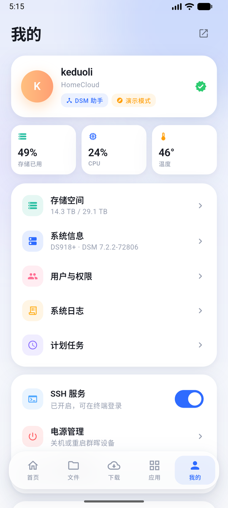
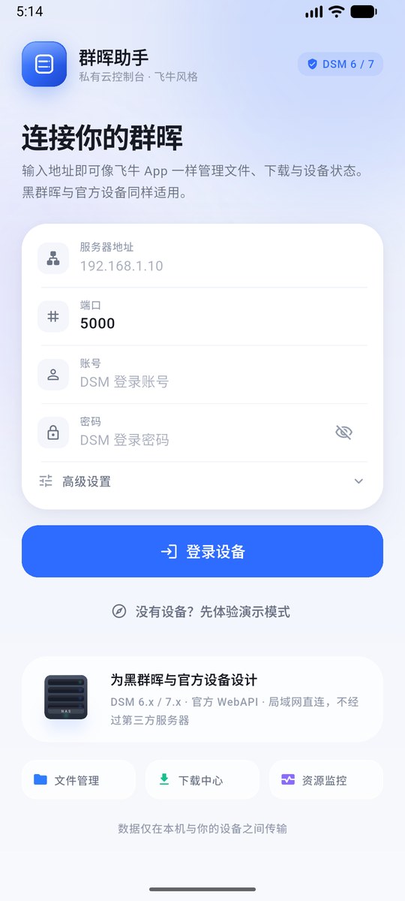
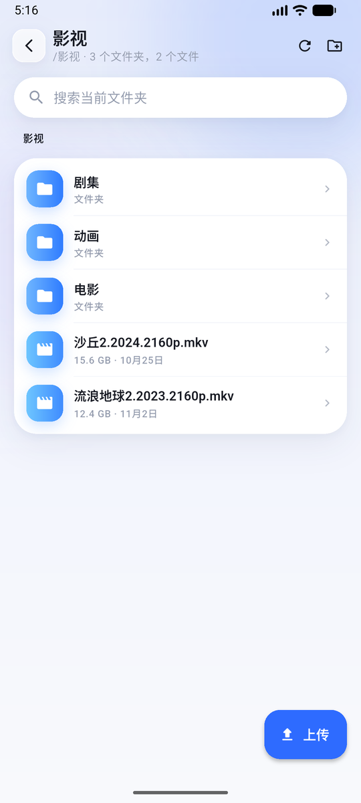
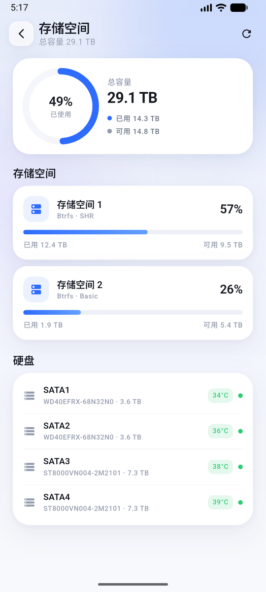

# 群晖助手 · DSM Helper

一套为 **黑群晖 / Synology DSM** 打造的第三方手机管理端。本仓库在原作者 [0ps/dsm_helper](https://github.com/0ps/dsm_helper) 的基础上做了彻底重写：界面参考 **飞牛 fnOS App** 的设计语言，交互按「一个 App 管完 NAS」的体验重新实现，功能通过群晖官方 WebAPI 直连设备，不经过任何第三方服务器。

> fork 自 [keduoli-lovely/dsm_helper](https://github.com/keduoli-lovely/dsm_helper) · Apache-2.0

## 界面预览

| 首页 | 文件 | 下载 |
| --- | --- | --- |
|  |  |  |

| 应用中心 | 资源监控 | 我的 |
| --- | --- | --- |
|  |  |  |

| 登录 | 文件浏览 | 存储空间 |
| --- | --- | --- |
|  |  |  |

## 主要功能

- **飞牛式首页**：连接状态、设备名、5×2 功能宫格、资源监控（CPU / 内存 / 存储环形图 + 网络 / 硬盘 / 温度）、存储空间、实时传输任务、下拉刷新
- **登录与设备管理**：DSM 6.x / 7.x 自适应、HTTP / HTTPS、自签证书忽略校验、两步验证（动态码）、多设备保存、自动登录、会话失效自动回到登录页
- **文件**：共享文件夹、目录浏览与面包屑、上传（兼容 Android SAF）、下载、重命名、删除、图片预览、当前目录搜索
- **下载**：Download Station（含 DSM 7 DownloadStation2 兼容）任务列表、进度与速度、暂停 / 继续 / 删除、添加链接
- **应用中心**：已安装套件、运行状态、启动 / 停止
- **资源监控**：CPU / 内存 / 网络 / 磁盘实时曲线，2 秒自动采样
- **设备**：系统信息、网络接口、存储空间与硬盘温度、SSH 开关、关机 / 重启、系统日志、用户、计划任务
- **体验**：深色模式、飞牛风格的渐变背景 / 大圆角卡片 / 悬浮导航 / 入场动画，内置演示模式

## 技术栈

- Flutter 3.38 / Dart 3.10（Material 3，跨 Android / Windows 桌面）
- `provider` 状态管理、`http`（自建 DSM WebAPI 客户端）、`shared_preferences`、`file_picker`、`url_launcher`
- 设计系统集中在 `lib/theme/app_theme.dart`，图表与设备插画全部为 `CustomPainter`，无重量级 UI 依赖

## 目录结构

```
lib/
  dsm/          群晖 WebAPI 客户端、业务接口、数据模型
  state/        登录会话、主题与应用状态
  theme/        颜色 / 字号 / 圆角 / 组件主题
  widgets/      卡片、环形图、图标块、导航、NAS 插画等
  pages/        登录、首页、文件、下载、应用、监控、设置等
  demo/         演示数据（无设备时体验完整界面）
tools/          本地 mock DSM、图标生成、截图脚本（开发用）
```

## 本地运行

```bash
flutter pub get
flutter run -d windows          # 桌面预览，窗口按手机比例
flutter run -d <android-device>
```

没有设备时，登录页点击「没有设备？先体验演示模式」，或使用：

```bash
flutter run --dart-define=DSM_DEMO=true
```

## 构建 Android APK

需要 JDK 17 与 Android SDK：

```bash
flutter build apk --release
# 产物：build/app/outputs/flutter-apk/app-release.apk
```

## 连接黑群晖

1. 确保手机和 NAS 在同一局域网，DSM 已开启 **File Station**（以及需要使用的 Download Station / 套件中心）
2. 在登录页填写地址、端口（HTTP 默认 `5000`，HTTPS 默认 `5001`）、DSM 账号和密码
3. 使用 HTTPS + 自签证书时，在「高级设置」中保持「忽略证书校验」开启
4. 普通账号也能登录，但套件启停、电源、SSH 等操作需要管理员权限

## 已知限制

- 相册入口直接浏览 `/photo` 共享目录，暂未接入 Synology Photos 的智能分类与时间线
- 文件搜索当前只搜索「最近修改」中的文件，尚未接入服务端全局搜索
- 暂未提供视频播放、缩略图列表、Docker / VMM 详情
- Download Station 的 BT 文件上传尚未实现（支持 http / https / magnet / ftp 链接）

## 开发工具

- `python tools/mock_dsm.py 5000`：本地伪 DSM 服务，可在没有 NAS 时验证登录与数据解析
- `python tools/make_icons.py`：生成 Android / Windows 应用图标
- `tools/screenshot.ps1`、`tools/tap.ps1`、`tools/scroll.ps1`：Windows 下的界面截图与自动化脚本

## License

Apache License 2.0，详见 [LICENSE](LICENSE)。
