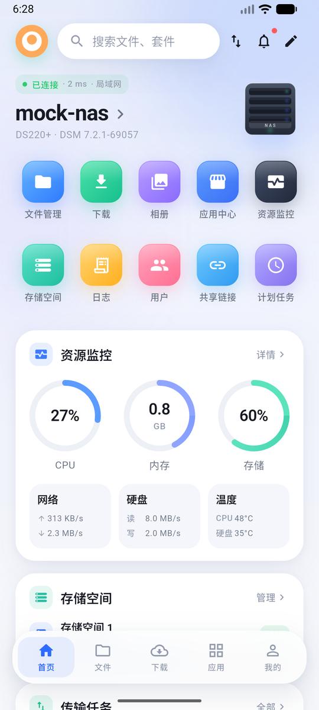
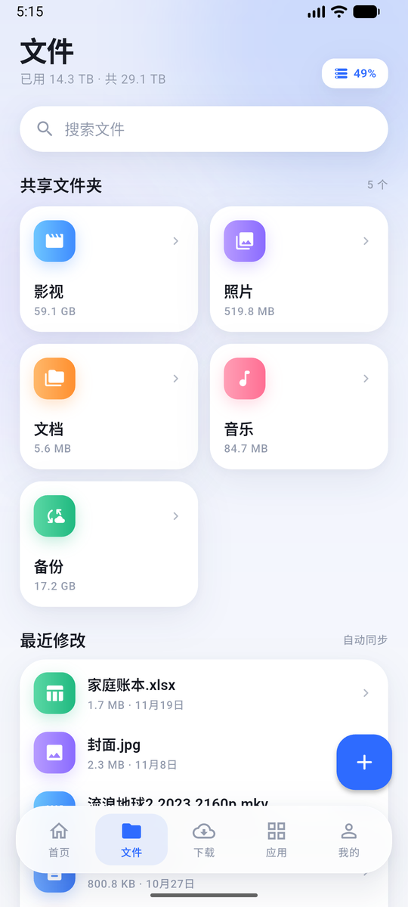
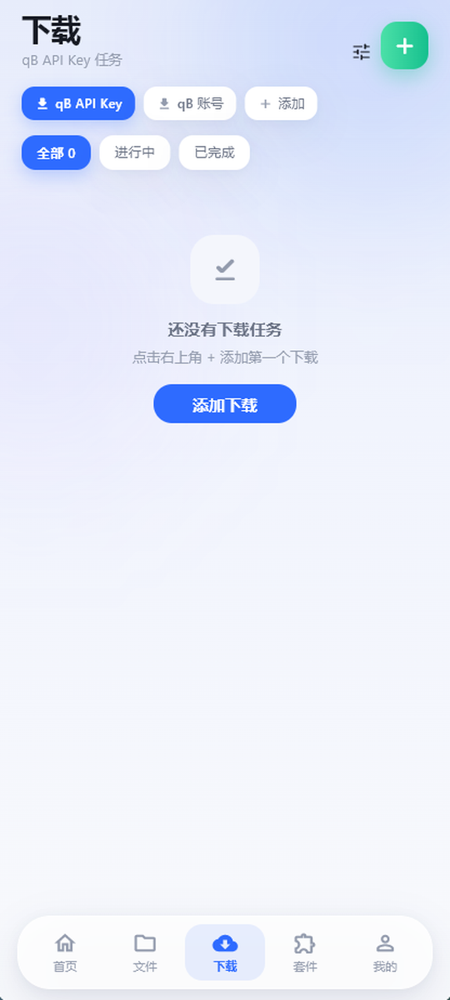
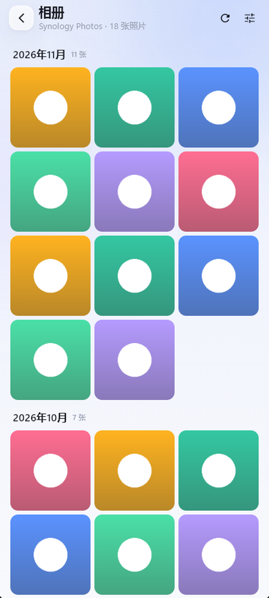
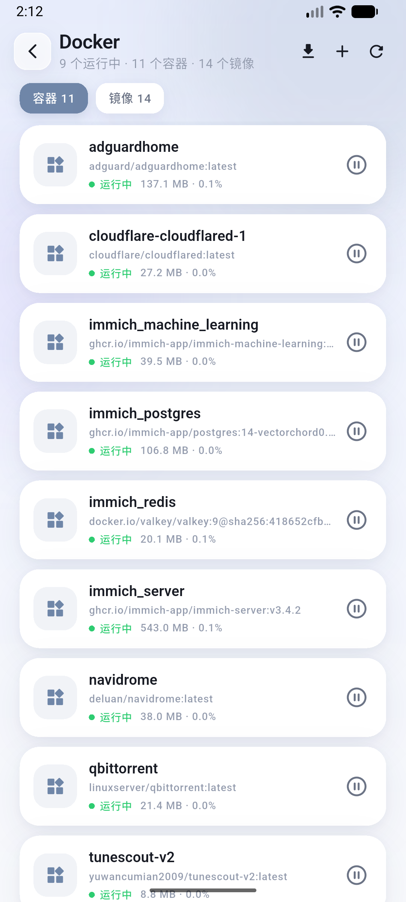
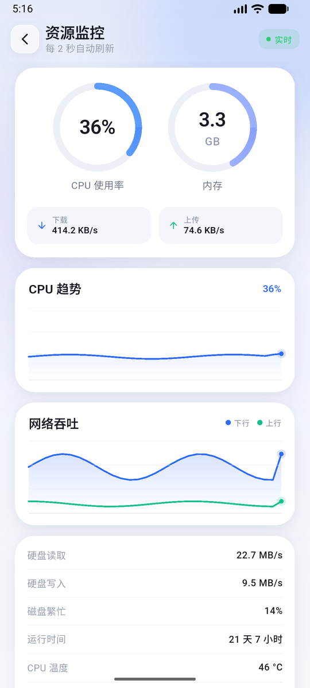
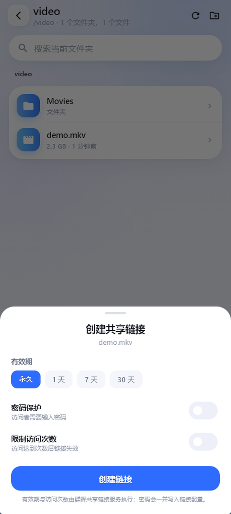

# 群晖助手 · DSM Helper

一套为 **黑群晖 / Synology DSM** 打造的第三方手机管理端。本仓库在原作者 [0ps/dsm_helper](https://github.com/0ps/dsm_helper) 的基础上做了彻底重写：界面参考 **飞牛 fnOS App** 的设计语言，交互按「一个 App 管完 NAS」的体验重新实现，功能通过群晖官方 WebAPI 直连设备，不经过任何第三方服务器。

> fork 自 [keduoli-lovely/dsm_helper](https://github.com/keduoli-lovely/dsm_helper) · Apache-2.0

## 界面预览

| 首页 | 文件 | 下载 |
| --- | --- | --- |
|  |  |  |

| 相册 | 套件中心 | Docker |
| --- | --- | --- |
|  |  |  |

| 我的 | 登录 | 资源监控 |
| --- | --- | --- |
|  |  |  |

| 共享链接设置 | | |
| --- | --- | --- |
|  | | |

## 主要功能

- **飞牛式首页**：实时连接状态（已连接 / 未连接 + 网络延迟）、本地头像、设备名、5×2 功能宫格、可自由添加/移除的卡片（资源监控、存储、传输任务、系统概览、网络、硬盘健康、最近文件、快捷操作、相册预览、套件状态、最新日志、Docker 容器）
- **登录与设备管理**：DSM 6.x / 7.x 自适应、HTTP / HTTPS、自签证书忽略校验、两步验证（动态码）、多设备保存、自动登录、会话失效自动回登录页
- **本地头像**：我的 → 头像，可选择本机图片；未选择时使用内置默认头像
- **文件**：共享文件夹（显示内部文件夹/文件数量）、目录浏览与面包屑、上传（兼容 Android SAF）、下载、重命名、删除、图片预览、群晖共享链接（可设置有效期、密码、访问次数）、当前目录搜索
- **下载**：支持 **qBittorrent（API Key 或账号密码两种登录）** 与 **Aria2**，可配置多个工具、局域网自动发现、任务进度/速度、暂停/继续/删除、添加链接
- **相册**：三种照片来源 —— **DSM 文件夹（递归读取子目录、分页懒加载、优先新图）**、**Synology Photos 时间线**、**Immich（地址 + API Key）**；按月分组、缩略图、大图预览，查看详情并创建共享链接
- **套件中心**：已安装套件、读取 DSM Web 端真实图标、运行状态与启停，系统服务不可停止；兼容 DSM 7 将 `status` 放在 `additional` 对象里的返回结构
- **Docker**：独立的容器管理页，支持容器列表、状态、端口、启动 / 停止 / 重启 / 删除、查看日志，镜像列表与拉取，以及创建容器；首页可添加「Docker 容器」展示组件
- **导航**：底部导航的根页面不显示返回按钮；从首页或列表压入的详情页始终显示返回，避免「有的页面能回、有的不能回」
- **资源监控**：CPU / 内存 / 网络 / 磁盘实时曲线，自动刷新；兼容 DSM 6 的数组与 DSM 7 的对象返回格式（含 `user_load`、KB 内存、`read_byte` 等字段），接口不可用时明确显示「无法获取」
- **设备**：系统信息、网络接口、存储空间与硬盘温度（无法读取时显示「温度无法获取」）、SSH 开关、关机 / 重启
- **日志**：按登录 / 文件 / 系统 / 错误筛选、搜索、清除日志
- **用户**：查看账号、邮箱与权限，支持修改描述和邮箱
- **体验**：深色模式、飞牛风格的渐变背景 / 大圆角卡片 / 悬浮导航 / 入场动画，内置演示模式

## 技术栈

- Flutter 3.38 / Dart 3.10（Material 3，跨 Android / iOS / Windows 桌面）
- `provider` 状态管理、`http`（自建 DSM WebAPI 客户端）、`shared_preferences`、`file_picker`、`path_provider`、`url_launcher`、`crypto`
- 设计系统集中在 `lib/theme/app_theme.dart`，图表与设备插画全部为 `CustomPainter`，无重量级 UI 依赖

## 目录结构

```
lib/
  dsm/          群晖 WebAPI 客户端、业务接口、数据模型
  downloads/    qBittorrent / Aria2 适配与发现
  photos/       Immich API 客户端
  state/        登录会话、主题、首页组件、下载工具、相册来源、本地头像
  theme/        颜色 / 字号 / 圆角 / 组件主题
  widgets/      卡片、环形图、图标块、导航、NAS 插画、用户头像等
  pages/        登录、首页、文件、下载、相册、套件、Docker、监控、设置等
  demo/         演示数据（无设备时体验完整界面）
tools/          本地 mock DSM、图标生成、截图脚本（开发用）
```

## 本地运行

```bash
flutter pub get
flutter run -d windows          # 桌面预览，窗口按手机比例
flutter run -d <android-device>
```

没有设备时，登录页点击「没有设备？先体验演示模式」，或使用：

```bash
flutter run --dart-define=DSM_DEMO=true
```

## 构建 Android APK

需要 JDK 17 与 Android SDK：

```bash
flutter build apk --release
# 产物：build/app/outputs/flutter-apk/app-release.apk
```

## 连接黑群晖

1. 确保手机和 NAS 在同一局域网，DSM 已开启 **File Station** 与 **套件中心**
2. 在登录页填写地址、端口（HTTP 默认 `5000`，HTTPS 默认 `5001`）、DSM 账号和密码
3. 使用 HTTPS + 自签证书时，在「高级设置」中保持「忽略证书校验」开启
4. 普通账号也能登录，但套件启停、电源、SSH、用户编辑、Docker 等操作需要管理员权限

## 头像

「我的」→ 头像 → 从相册选择一张本地图片即可；图片只保存在本机。未选择时使用内置默认头像。

## 共享链接

在文件或文件夹的操作菜单选择「创建共享链接」，可以设置：

- 有效期：永久 / 1 天 / 7 天 / 30 天
- 密码保护
- 允许访问次数

创建后会显示链接、有效期与密码状态，可直接复制或打开。选项通过群晖 `SYNO.FileStation.Sharing` 的 `date_expired`、`password`、`expire_times` 参数写入。

## 下载工具

首页进入「下载」→ 右上角调节按钮，可以：

- **qBittorrent**：地址 + 端口，可填账号密码登录，也可填 qBittorrent 5.2+ 的 API Key（Bearer）
- **Aria2**：地址 + 端口 + RPC Secret（对应 --rpc-secret）
- 点击「扫描局域网」自动发现常见的 8080 / 8081 / 6800 端口

## 相册来源

「相册」→ 右上角调节按钮，可以选择：

- **DSM 文件夹**：递归读取所选目录及子目录中的图片，分页懒加载并按修改时间优先新图；没有 photo 文件夹也没关系，可以在选择目录时新建
- **Synology Photos**：读取群晖 Photos 的时间线与缩略图
- **Immich**：填写 Immich 地址与 API Key（需要 `asset.read` / `asset.view` 权限）

## 已知限制

- 暂未提供视频播放、缩略图列表与 VMM 虚拟机详情
- Docker 的创建 / 拉取依赖 DSM Container Manager 的接口与镜像源，不同 DSM 版本参数略有差异，失败时会显示原因
- 文件搜索当前只搜索「最近修改」中的文件，尚未接入服务端全局搜索
- qBittorrent / Aria2 的 BT 种子文件上传尚未实现（支持 http / https / magnet / ftp 链接）
- 日志清除、用户编辑等管理接口在不同 DSM 版本上可能存在差异，失败时会给出提示
- 内网穿透场景下，下载/图片仍使用登录时填写的地址；内外网双地址自动切换尚未实现

## 开发工具

- `python tools/mock_dsm.py 5000`：本地伪 DSM 服务，内置文件、下载、套件、共享链接、Synology Photos、Immich、Docker 等接口，可在没有 NAS 时验证完整流程
- `python tools/make_icons.py`：生成 Android / Windows / iOS 应用图标
- `tools/screenshot.ps1`、`tools/tap.ps1`、`tools/scroll.ps1`：Windows 下的界面截图与自动化脚本

## License

Apache License 2.0，详见 [LICENSE](LICENSE)。
